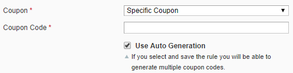
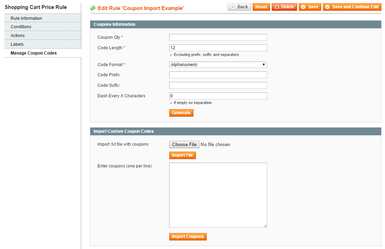
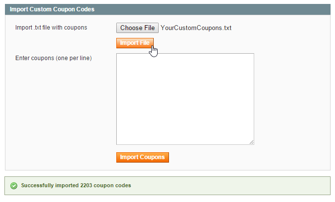
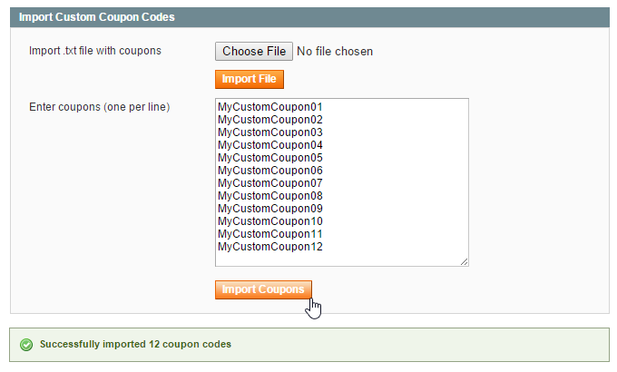
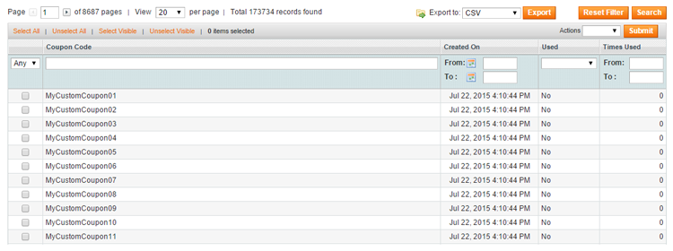

# Importing Coupon Codes in Magento

To import custom coupon codes in Magento, navigate to **Promotions > Shopping Cart Price Rules** in the top Admin Panel menu.

Select a shopping cart price rule from the grid or click the 'Add New Rule' button in the top right corner of the page to create a new rule.

In the Rule Information tab, select 'Specific Coupon' from the 'Coupon' dropdown menu and tick the 'Use Auto Generation' checkbox, then save the shopping cart price rule.

After saving the rule, click **Manage Coupon Codes** in the left side menu.

Use the **Import Custom Coupon Codes** section to bulk import your coupons from a text file or to upload a custom coupon list.

## Bulk Importing Coupon Codes

If you want to import a large amount of custom coupons at once you can upload them using a text (.txt) file.

In order to import a text file, make sure that your coupons are entered in a **list format with one coupon per line**.

Click 'Choose File' to select the text file and then 'Import File' to start the upload.

After the coupons are successfully imported a confirmation message will appear under the Import Custom Coupon Codes section.

## Importing Custom Coupon Lists

If you need to import only a limited amount of custom coupons, you could simply enter them in the text area or copy-paste them from another source like an Excel sheet or a website.

Make sure you enter or paste the coupon using a **list format with one coupon per line** and click 'Import Coupons' to upload them.

After the coupon codes are successfully imported a confirmation message will appear under the Import Custom Coupon Codes section.

## Managing Imported Coupon Codes

Because the Coupon Import extension is AJAX-based, imported coupon codes are instantly added to the overview at the bottom of the Manage Coupon Codes tab without refreshing the page.

You can upload an unlimited amount of custom discount coupons at once, however extremely large amounts might take some time to process, while relatively small amounts (e.g. a couple of thousands) are imported almost instantly.

---

[Documentation index](./README.md) · [README](../README.md) · [Online version](https://plugin.company/knowledge-base/docs/magento-coupon-import/user-manual/importing-coupon-codes-in-magento/)
